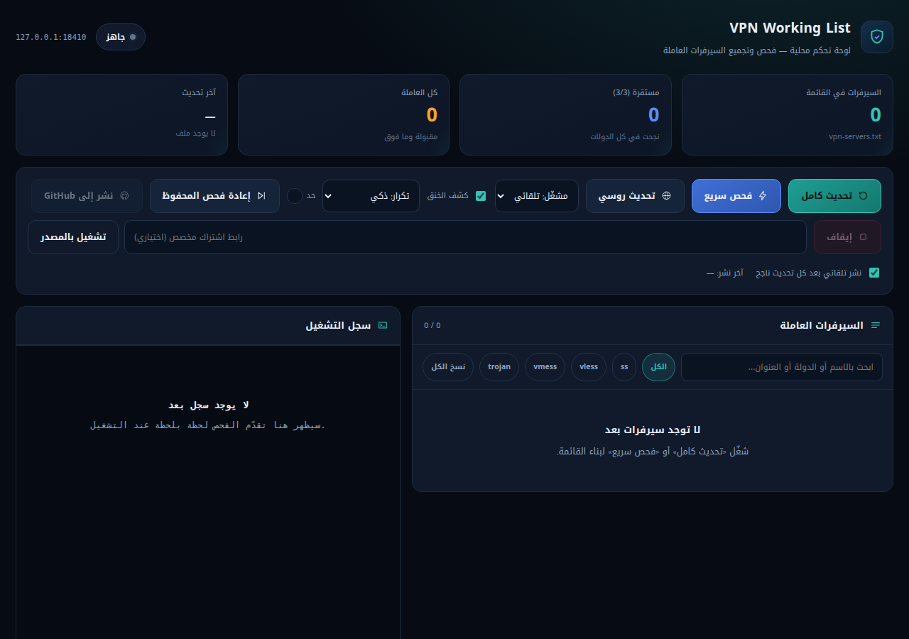

# VPN Server Filter — مفلتر السيرفرات

A local Linux desktop app that turns a pile of VPN subscriptions into a short
list of servers that **actually connect**. It fetches public subscription
lists, removes duplicates, tests every link with the real cores (sing-box and
Xray), drops dead and throttled servers, and writes one importable file plus a
ready-to-use Clash configuration.

Built with Russian mobile networks in mind: links are ranked and filtered by
Russian whitelist SNI domains, and carrier profiles model the throttling
behaviour of MTS, Megafon, Beeline and Tele2.



> The interface is in Arabic (RTL). Everything runs locally: no cloud, no
> telemetry, no external requests except the subscription URLs you choose.

## Features

- **Desktop app, not a browser tab.** A dedicated window with its own icon,
  launcher and menu entry. No Electron, no Node runtime.
- **Real connectivity tests.** Every link is converted to a sing-box/Xray
  outbound and tested for several passes; only stable survivors are exported.
- **Russia-first sources.** A curated registry of ~25 GitHub/GitVerse lists
  (whitelist, mobile, CIDR), plus a bounded GitHub discovery cache refreshed
  every 24 hours. Large generic lists are opt-in (`--deep-sources`, or the
  «مصادر عميقة» switch in the app window).
- **Smart de-duplication.** Normalises links (including base64, markdown, JSON
  and HTML wrapping) and collapses by `host:port:sni`, keeping the variant
  with the best SNI score.
- **Russia whitelist ranking.** Before a limited run, links carrying a Russian
  whitelist SNI (`yandex.ru`, `vk.com`, `max.ru`, `x5.ru`, …) are tested first,
  so a 200-link trial tests the useful 200 — not an alphabetical slice.
- **Malformed links are dropped early**, before any network work.
- **Silent-throttling detection** per carrier, with configurable thresholds.
- **Outputs:** one merged file, a Clash/Mihomo config with Russia split
  routing, a simple Clash config, per-run stats and a source health report.
- **Dead sources never abort a run.** Every subscription is logged in
  `source_health.json` with its link count or error.

## Requirements

- Linux (tested on Ubuntu/KDE, X11 and Wayland)
- Python 3.8+
- Chrome/Chromium for the app window (Firefox or the default browser works too)
- ~50 MB of free disk for the sing-box + Xray cores, downloaded automatically
  on the first full update

## Install

### From the release archive (recommended)

Download the single-file package `مفلتر السيرفرات` from the latest release,
put it anywhere, then:

```bash
bash "مفلتر السيرفرات"
```

The installer:

1. unpacks the app to `~/.local/share/mofilter/vpn-web-app.py`
2. installs or upgrades the `vpn-list` skill in
   `~/.config/opencode/skills/vpn-list` (with a timestamped backup)
3. installs the desktop entry, icon and desktop shortcut
4. opens the app window

After that, launch it from the application menu or the desktop icon — no
terminal needed.

### From source

```bash
git clone https://github.com/Ahmed-vrn/mofilter.git
cd mofilter
bash "مفلتر السيرفرات"
```

## Usage

Click the app icon. The window has four actions:

| Button (Arabic) | Meaning |
| --- | --- |
| تحديث كامل | Full update: fetch sources, dedupe, test everything |
| تحديث روسي | Russia update: fresh Russia-focused sources + carrier filter |
| فحص سريع | Quick test of the current link list |
| نشر إلى GitHub | Optional: publish the result to your own repository |

Options:

```bash
bash "مفلتر السيرفرات"                    # install and open the window
bash "مفلتر السيرفرات" --no-open          # start the local server only
bash "مفلتر السيرفرات" --no-desktop       # skip the desktop shortcut
bash "مفلتر السيرفرات" --port 9000        # custom port
bash "مفلتر السيرفرات" --keep-skill       # never upgrade an existing skill
bash "مفلتر السيرفرات" --help
```

Installed paths:

| Path | Content |
| --- | --- |
| `~/.local/share/mofilter/` | app, desktop launcher, logs, skill backups |
| `~/.config/opencode/skills/vpn-list/` | the `vpn-list` skill (CLI + docs) |
| `~/.local/share/vpn-list/` | fetched links, cores, reports, Clash configs |
| `~/Desktop/vpn-servers.txt` | the merged working servers |
| `~/Desktop/vpn-list/` | full result set |

Paths follow `XDG_DATA_HOME` / `XDG_CONFIG_HOME` and the real desktop folder
(`xdg-user-dir DESKTOP`) when they are set; the table shows the defaults.

## Russia mode

Carrier profiles live in the skill (`references/carrier-profiles.md`):

- **MTS** — Reality is the best option, xhttp blocked
- **Megafon** — strict SNI, xhttp packet-up works
- **Beeline** — unstable, xhttp preferred, UDP blocked
- **Tele2** — lenient

A link survives the filter only if its SNI matches the carrier's accepted
domains; the live test still makes the final decision. The registry has three
tiers:

| Tier | Content | When |
| --- | --- | --- |
| core | ~25 curated GitHub/GitVerse lists | every run |
| discovered | newest GitHub repos in the Russia topics, probed and capped | once per 24 h |
| deep | very large mixed lists (thousands of links), incl. the `rjsxrd` whitelist-bypass feed (vless + ss + hysteria2, hourly) | `--deep-sources` / `VPN_DEEP=1` / app switch |

## Command line

The same engine is available without the window:

```bash
S=~/.config/opencode/skills/vpn-list/scripts

python3 $S/run.py --single                                  # full run
python3 $S/run.py --single --carrier mts --extra-sources    # Russia mobile
python3 $S/run.py --links-file /tmp/links.txt --single      # test your own list
python3 $S/run.py --single --limit 300                      # quick trial
python3 $S/sources_ru.py --refresh --discover               # re-check sources
python3 $S/sources_ru.py --list                             # show the registry
```

### About `--single` and `--no-confirm`

Both flags are passed internally by the web UI when it spawns `run.py`:

- `--single` — run one test pass and write the result immediately
  (instead of the default multi-phase batch mode).
- `--no-confirm` — never prompt on stdin; assume "yes" for any
  confirmation. Required because the UI runs with `stdin=DEVNULL`.

From a terminal you can use them directly:

```bash
python3 $S/run.py --single --no-confirm
```

Useful environment variables: `VPN_CARRIER`, `VPN_LIMIT`, `VPN_DEEP=1`,
`VPN_SOURCE_TIMEOUT`, `VPN_SOURCES_TTL`.

## Development

The repository is self-contained: the app is one Python file, the skill lives
in `skill/`, and the portable package is rebuilt from both.

```bash
python3 test_selftest.py     # unit tests, Python stdlib only
bash fix-mofilter.sh         # maintenance fixes + tests + rebuild
bash build_package.sh        # rebuild the portable "مفلتر السيرفرات" file
```

`build_package.sh` refuses to build when `APP_VERSION` and `skill/.version`
differ, verifies the extracted payload, and keeps the previous package as
`مفلتر السيرفرات.bak`.

## Security

- **No credentials in this repository.** `github.json` (the publishing token)
  is git-ignored; `github.example.json` is an empty template.
- The optional "publish to GitHub" feature reads the token from
  `~/.config/vpn-list/github.json` (mode `600`), never from the repo.
- The app binds to `127.0.0.1` only and rejects foreign `Host`/`Origin`
  headers, so a web page cannot drive the local API.
- The UI sends `X-Frame-Options: DENY` and a restrictive CSP.

## Moving to another computer

Copy the project folder (or the single-file `مفلتر السيرفرات` package) to the
new machine and run `bash "مفلتر السيرفرات"` again. The desktop entry is
generated per user, so it is never copied between machines. Linux only.

## Uninstall

```bash
rm -f  ~/.local/share/applications/mofilter.desktop
rm -f  ~/Desktop/"مفلتر السيرفرات.desktop"
rm -rf ~/.local/share/mofilter
rm -rf ~/.config/opencode/skills/vpn-list   # optional
rm -rf ~/.local/share/vpn-list              # optional: results and cores
```

## Project layout

```
مفلتر السيرفرات        self-extracting installer (app + skill + desktop)
vpn-web-app.py         the app (local HTTP UI + runner)
skill/                 vpn-list skill (run.py, sources, references)
desktop/               window launcher, icons, desktop-entry installer
packaging/             portable-package header template
build_package.sh       rebuilds the single-file portable package
fix-mofilter.sh        idempotent project maintenance script
test_selftest.py       unit tests
docs/screenshot.png    UI screenshot
اقرأني.txt             full Arabic user guide
README.ar.md           Arabic README
github.example.json    publishing settings template (no token)
```

The bundled `vpn-list` skill contains the whole pipeline (`fetch.py`,
`sources_ru.py`, `retest.py`, `links2sb.py`, `clash_build.py`,
`enrich.py`) and its own documentation in `SKILL.md` and `references/`.

## FAQ

**Why is the test slow?**
A full run tests every link with real cores (sing-box/Xray), 3 passes each.
1500+ links can take hours. Set the **limit** field (e.g. 200–300) for a
quick trial — links with a Russian whitelist SNI are tested first, so a
limited run tests the useful subset.

**Can I run it on Windows or macOS?**
No — the installer, desktop entry and core downloads target Linux. The
Python app itself is portable, but the desktop integration is Linux-only.

**Do I need OpenCode or DeepSeek Harness?**
No. The app is fully standalone (Python stdlib only). The skill is copied
to `~/.config/opencode/skills/vpn-list` as a conventional path, but no
agent is required.

**Where is the GitHub token stored?**
In `~/.config/vpn-list/github.json` (mode `600`), never in the repo.
Without it, the publish button is disabled and auto-sync is skipped.

**How do I reset everything?**
See the **Uninstall** section, then re-run the installer.

## Changelog

### 1.5.0 — 2026-11-20

- **New source:** `whoahaow/rjsxrd` → `bypass/bypass-all.txt`, deep tier only.
  Measured 2026-11-20: 474 usable links (vless, shadowsocks, hysteria2),
  refreshed hourly; ≈25% of a 30-link sample survived two sing-box passes.
- **Deep tier is now one click:** a «مصادر عميقة» checkbox next to
  «كشف الخنق» toggles the deep lists from the window. The choice is stored in
  `webapp-settings.json` (`deep`), so no terminal or `VPN_DEEP=1` is needed.
- `/api/settings` validates and persists the `deep` flag with the other
  options.
- App, skill and desktop launcher share version **1.5.0** (the build refuses
  mismatched versions).

### 1.4.1 — 2026-11-18

- Unified portable package, token-free builds (`--github-token` is local-only),
  XDG paths, hostile Host/Origin rejection, CSP, unit tests.

## License

Personal use. Third-party subscription lists and VPN servers belong to their
respective owners; this project only tests and organises links.
